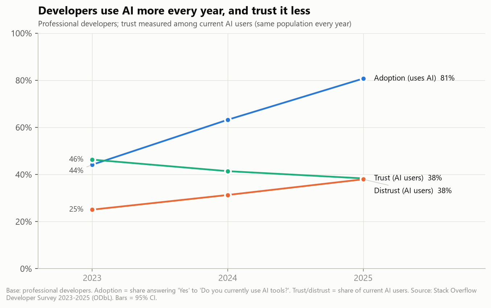

# Developer AI Adoption vs Trust Analytics

**"Developers use AI more every year but trust it less. Who trusts it, and why?"**

An end-to-end analysis of the Stack Overflow Developer Survey 2023–2025 (203,812 responses), built with free tools only:

- a cleaning pipeline that lines up questions across three years and documents every mapping
- a DuckDB SQL layer
- descriptive analysis and logistic regression with controls
- robustness checks for self-selection bias
- an interactive dashboard and a short insight memo



## Key findings

| | 2023 | 2024 | 2025 |
|---|---|---|---|
| Professional developers using AI tools | 44% | 63% | **81%** |
| AI users who **trust** AI output accuracy | 46% | 41% | **38%** |
| AI users who **distrust** AI output accuracy | 25% | 31% | **38%** |

*Trust and distrust are measured among current AI users, the only population asked the question in all three years.*

1. **The trust decline is real.** With experience, role, company size, country and age held constant, the odds of distrust are **1.87× higher in 2025 than in 2023**. Reweighting each year to the 2023 respondent mix does not change the picture.
2. **Experience is the strongest personal predictor.** Developers with 30+ years of coding have **about 3× the odds** of distrust compared with those who have 0–4 years. How they use AI explains only about a quarter of that gap.
3. **Occasional users are the most sceptical.** In 2025, 66% of monthly-or-less users distrust AI, against 28% of daily users. Agent users distrust less.
4. **"Almost right, but not quite" is not the differentiator.** 76% of professional AI users report it, but it shows **no association** with distrust once other factors are controlled (OR 0.97). **"Debugging AI code takes longer"** is the frustration that tracks distrust: **+15 percentage points**, OR 2.2.
5. **Company size doesn't matter once controls are added.** Role and country do: embedded and infra roles and Western Europe distrust most, India least.

📄 **Read the memo:** [reports/insight_memo.pdf](reports/insight_memo.pdf) ([Markdown version](reports/insight_memo.md))
📊 **Open the dashboard:** [dashboard/ai_trust_dashboard.html](dashboard/ai_trust_dashboard.html). It is a single file that works offline. Download it and open it in a browser.

## The tricky parts and how they were handled

| Problem | What was done |
|---|---|
| **Questions changed between years** | Every variable is mapped in [`mappings/question_crosswalk.csv`](mappings/question_crosswalk.csv) with a comparability tier: **A** identical, **B** harmonised by a documented recode, **C** not comparable. All answer recodes live in [`mappings/value_maps.yaml`](mappings/value_maps.yaml); the pipeline stops if any raw label is unmapped. Exact wording per year: [`reports/data_dictionary.md`](reports/data_dictionary.md). |
| **Columns swapped in 2023** | In the 2023 file, the *trust* question is stored as `AIBen` and the *benefits* question as `AIAcc`, the reverse of 2024/25. Caught by profiling the values and confirmed against the official schema. |
| **Different people were asked the trust question each year** | 2023: users + planners. 2024: users only. 2025: everyone. The official year-on-year trust figures therefore compare different populations. This project uses **current AI users** as the comparable base ([fig02](reports/figures/fig02_official_vs_comparable_trust.png)). |
| **Multi-select answers** | Split into 0/1 columns (blank when the whole question was skipped) and long bridge tables for SQL and BI tools. 2025's "mostly AI / partially AI" task matrix is merged into "currently uses". |
| **Self-selected respondents** | Each year's composition is compared ([fig11](reports/figures/fig11_sample_composition.png)). 2024 and 2025 are raked to the 2023 mix ([fig15](reports/figures/fig15_reweighted_trend.png)). 12 robustness specifications are run ([fig14](reports/figures/fig14_robustness.png)). Everything is reported as association, not cause. |
| **Quoting the right numbers** | The pipeline reproduces Stack Overflow's published tables: **84/84 percentages match within ±1 pp** (largest gap 0.60 pp; see [`reports/tables/benchmark_check.csv`](reports/tables/benchmark_check.csv)). |

## Tech stack (all free)

| Layer | Tools |
|---|---|
| Data | Stack Overflow Developer Survey 2023–2025 ([survey.stackoverflow.co](https://survey.stackoverflow.co/), ODbL) |
| Cleaning and analysis | Python 3.11–3.12, pandas, numpy, statsmodels, scipy |
| SQL | DuckDB (`sql/01_views.sql`, `sql/02_segment_metrics.sql`) |
| Charts | matplotlib (static, colour-blind-checked palette), Plotly (interactive) |
| Dashboard | Self-contained HTML (Plotly.js), plus a Power BI kit: star-schema CSVs, DAX measures, theme and build guide in [`dashboard/powerbi/`](dashboard/powerbi/) |
| Notebooks | Jupyter (`notebooks/01–04`, executed with outputs) |
| Memo | Markdown → HTML → PDF (headless Edge or Chrome) |

## Reproduce it

```bash
python -m venv .venv
.venv\Scripts\activate            # macOS/Linux: source .venv/bin/activate
pip install -r requirements.txt
python run_pipeline.py            # download → harmonise → validate → build_db → descriptives → models → robustness → dashboard → memo → build_site
```

- The full run takes about 10 minutes; the download is about 460 MB.
- To run a single step: `python run_pipeline.py --only models`. To resume from a step: `--from descriptives`.
- `src/data_dictionary.py` regenerates the data dictionary.

## Deploy (free, static)

The last pipeline step, `build_site`, assembles a static website in `site/`: a landing page with the headline numbers (read from `reports/tables/`), the interactive dashboard, the memo (HTML + PDF), all figures and the aggregate CSVs. Only aggregates are published, no respondent-level data.

```bash
python run_pipeline.py --only build_site     # builds site/ from the committed outputs (no raw data needed)
python -m http.server 8000 -d site           # preview at http://localhost:8000
```

**GitHub Pages (automatic):** push to `main`, then in the repository go to *Settings → Pages → Source = GitHub Actions*. The workflow [`.github/workflows/deploy-pages.yml`](.github/workflows/deploy-pages.yml) rebuilds the dashboard, memo and site from the committed tables and publishes them at `https://<user>.github.io/<repo>/`. It needs only [`requirements-site.txt`](requirements-site.txt), not the 460 MB raw data.

**Any other static host** (Netlify, Vercel, Cloudflare Pages): publish the `site/` folder as is; there is no server or build step to configure.

## Project structure

```
├── run_pipeline.py              one-command pipeline
├── mappings/                    question_crosswalk.csv + value_maps.yaml (every cross-year mapping)
├── src/
│   ├── download.py              fetch raw data + official result tables
│   ├── load.py / harmonise.py   clean, recode, harmonise -> respondents.parquet + bridge tables
│   ├── multiselect.py           multi-select -> 0/1 columns + long bridge tables
│   ├── validate.py              row counts + benchmark vs official tables
│   ├── build_db.py              DuckDB database, SQL layer, Power BI / Tableau CSV exports
│   ├── descriptives.py          segment tables + charts (Wilson 95% CIs, n >= 100 rule)
│   ├── models.py                logistic regressions, odds ratios, marginal effects
│   ├── robustness.py            raking weights + 12 alternative specifications
│   ├── stats_utils.py           Wilson CI, raking, fast ordered logit
│   ├── dashboard.py             self-contained HTML dashboard
│   ├── memo.py                  memo -> HTML/PDF
│   └── build_site.py            static website in site/ (landing page + dashboard + memo) for deployment
├── .github/workflows/           GitHub Pages deployment
├── sql/                         DuckDB views and segment metrics
├── notebooks/                   01 explore raw · 02 descriptives · 03 regression · 04 robustness
├── reports/                     insight memo, data dictionary, figures/, tables/
├── dashboard/                   ai_trust_dashboard.html + powerbi/ build kit
└── data/                        raw/ (downloaded), interim/, processed/ (git-ignored except small aggregates)
```

## Limitations

- **Not representative of all developers.** Respondents are self-selected and engaged with Stack Overflow. Reweighting corrects only the observed composition.
- **2025 AI non-response.** The 2025 AI section was optional, and about 31% of 2025 respondents skipped it.
- **Associations only.** The data is cross-sectional and self-reported; for example, trust may drive frequent use rather than the reverse.
- **Single-year questions.** Questions asked in only one year (frustrations, agents, use frequency, all 2025) are analysed within that year only.

## Data licence

The Stack Overflow Developer Survey data is made available under the [Open Database License (ODbL)](https://opendatacommons.org/licenses/odbl/1-0/). This repository contains derived aggregates only; raw files are downloaded by `src/download.py`.

See [`ASSUMPTIONS_AND_DECISIONS.md`](ASSUMPTIONS_AND_DECISIONS.md) for every assumption and judgement call made in this project.
