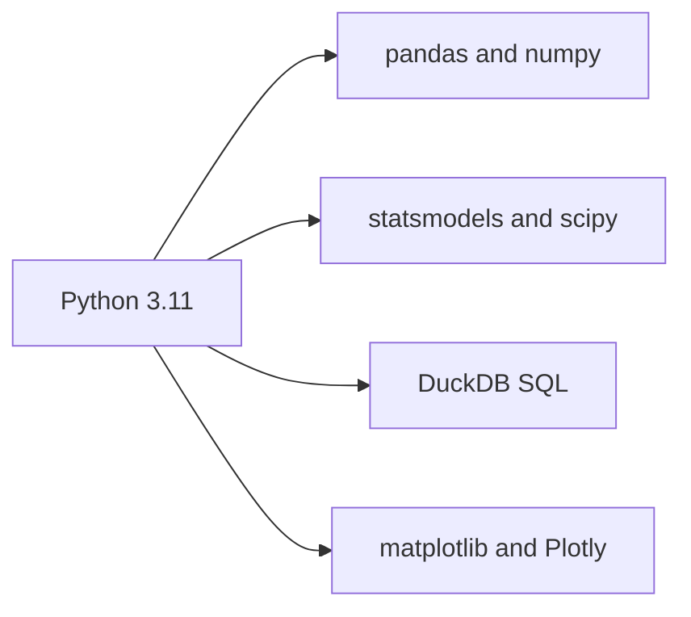

# 01 · Overview

What the project does, who it is for, and what it is built with.

## The question

Developers adopt AI tools more every year, but their trust in AI accuracy is falling. This project measures that gap and finds **who** distrusts AI and **why**, using the Stack Overflow Developer Survey for 2023, 2024, and 2025.

## What it produces

- A cleaned dataset that lines up questions across three years ([data/processed/respondents.parquet](../data/processed/respondents.parquet))
- Descriptive tables and 16 charts ([reports/figures/](../reports/figures/))
- Logistic regression results (odds ratios, marginal effects)
- An interactive HTML dashboard ([dashboard/ai_trust_dashboard.html](../dashboard/ai_trust_dashboard.html))
- A short insight memo ([reports/insight_memo.pdf](../reports/insight_memo.pdf))

## Who it is for

- **Readers:** developer-tools product teams and engineering leaders planning an AI rollout.
- **Reviewers:** anyone checking the method — every mapping and assumption is written down, never hidden in code.

## Why it is built this way

- **All free tools.** No paid services, no server, no cloud account needed.
- **Reproducible.** One command rebuilds everything from the raw files.
- **Honest.** Results are reported as *associations*, not causes, and the numbers are checked against Stack Overflow's official figures.

## Tech stack

Python does the cleaning and stats; DuckDB runs the SQL layer; matplotlib and Plotly draw the charts.

| Layer | Tool |
|---|---|
| Language | Python 3.11 |
| Data wrangling | pandas, numpy, pyarrow |
| SQL | DuckDB |
| Statistics | statsmodels, scipy |
| Charts | matplotlib (static), Plotly (dashboard) |
| Config | YAML + CSV mapping files |
