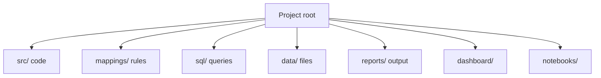

# 03 · Folder Structure

What each important folder and file is for.

Top-level folders: code, the mapping rules, the SQL, the data, and the outputs.

## Code and rules

- [src/](../src/) — all Python modules (one per pipeline step plus helpers). See [02-architecture.md](02-architecture.md).
- [mappings/](../mappings/) — the cross-year rules, kept out of the code on purpose:
  - `question_crosswalk.csv` — which raw column in each year maps to each variable.
  - `value_maps.yaml` — how answer labels are recoded.
- [sql/](../sql/) — DuckDB views and segment metrics run during `build_db`.

## Data (mostly git-ignored)

- `data/raw/<year>/` — original survey CSVs, never edited. Re-download with `download.py`.
- `data/interim/` — one cleaned parquet file per year.
- `data/processed/` — the final combined parquet, the DuckDB database, and Power BI CSV exports.

## Outputs

- `reports/figures/` — PNG charts (`fig01`…`fig15`).
- `reports/tables/` — CSV tables behind the charts and the benchmark check.
- [reports/insight_memo.md](../reports/insight_memo.md) — the written memo (also HTML and PDF).
- [reports/data_dictionary.md](../reports/data_dictionary.md) — exact question wording per year.
- [dashboard/](../dashboard/) — the HTML dashboard plus a Power BI build kit.
- [notebooks/](../notebooks/) — Jupyter notebooks for exploring the same steps interactively.

## Root files

- [run_pipeline.py](../run_pipeline.py) — the one-command runner.
- [requirements.txt](../requirements.txt) — pinned Python packages.
- [README.md](../README.md) — the project's public front page.
- [ASSUMPTIONS_AND_DECISIONS.md](../ASSUMPTIONS_AND_DECISIONS.md) — every judgement call.

## Why keep rules in separate files

The crosswalk and value maps live in `mappings/`, not inside Python. Anyone can read or change a mapping without touching code, which is what makes the analysis easy to review and trust.
