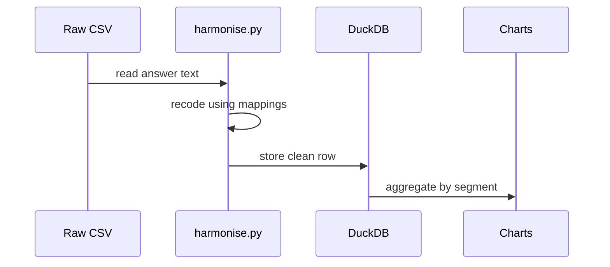

# 04 · Data Flow

How one survey answer travels from a raw file all the way to the dashboard.

## The journey of one answer

The raw text is recoded into a clean value, stored in the database, then summarised into charts.

## Step by step

1. **Read.** [load.py](../src/load.py) reads the raw CSV as text, keeping only the columns the crosswalk needs. It adds `survey_year` and a unique `resp_id` like `2025_000123`.
2. **Recode.** [harmonise.py](../src/harmonise.py) looks up each answer in [value_maps.yaml](../mappings/value_maps.yaml). Example: the three 2025 "Yes, I use AI..." options all become `"Yes"`. If any label is missing from the map, the pipeline stops with an error.
3. **Build outcomes.** It creates the analysis flags, e.g. `uses_ai`, `trusts_ai`, `distrusts_ai`, and buckets like `exp_bucket` (years of experience).
4. **Store.** All years are combined into [respondents.parquet](../data/processed/respondents.parquet) (one row per person per year). Multi-select answers also go into separate *bridge tables*.
5. **Load to DuckDB.** [build_db.py](../src/build_db.py) loads the parquet into [survey.duckdb](../data/processed/survey.duckdb) and runs the SQL layer to build dimensions and metrics.
6. **Summarise.** [descriptives.py](../src/descriptives.py), [models.py](../src/models.py), and [robustness.py](../src/robustness.py) read the parquet, compute shares and regressions, and save tables and figures.
7. **Publish.** [dashboard.py](../src/dashboard.py) and [memo.py](../src/memo.py) turn those tables into the dashboard and memo.

## Two important rules

- **Unknown vs no.** If someone skipped a whole question, its value stays *missing* (`NaN`), never `0`. This keeps denominators honest.
- **Comparable base.** Each year asked the trust question to a different group, so trust is compared only among **current AI users**, who were asked in all three years. See [05-harmonisation-and-crosswalk.md](05-harmonisation-and-crosswalk.md).
