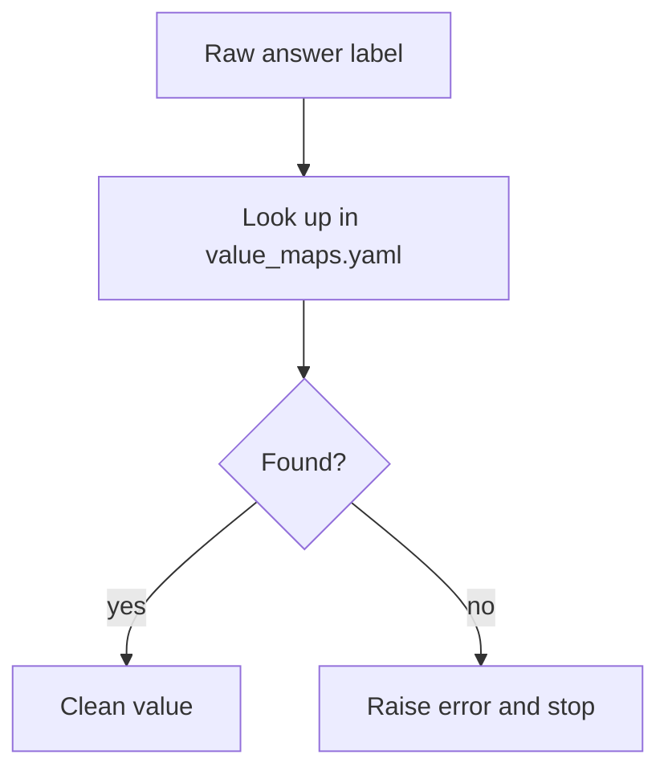

# 05 · Harmonisation and the Crosswalk

The core work: making three surveys with different questions comparable. Code: [harmonise.py](../src/harmonise.py), [load.py](../src/load.py), [multiselect.py](../src/multiselect.py). Rules: [mappings/](../mappings/).

## The problem

The survey changes each year — questions get reworded, answer options change, columns get renamed. You cannot just stack the three files. Every variable needs a documented rule saying how to line it up.

## The two rule files

- **[question_crosswalk.csv](../mappings/question_crosswalk.csv)** — one row per variable: which raw column it comes from in each year, whether wording changed, and how comparable it is.
- **[value_maps.yaml](../mappings/value_maps.yaml)** — how each answer label is recoded (e.g. three "Yes" options collapse into one).

## Comparability tiers

Every variable gets a tier, so charts only compare what is safe to compare:

- **A — identical:** same wording and options. Safe to trend.
- **B — harmonisable:** small changes fixed by a documented rule. Usable after mapping.
- **C — not comparable:** new or changed meaning. Used within its own year only.

## How recoding works

Any label not in the map stops the pipeline, so silent mistakes cannot slip through.

## Two tricky cases handled here

- **The 2023 column swap.** In 2023 the *trust* question is stored in column `AIBen` and *benefits* in `AIAcc` — the reverse of later years. This is fixed in [harmonise.py:21](../src/harmonise.py#L21) (`TRUST_COL`).
- **Different audiences.** The trust question reached different groups each year. `harmonise.py` builds two bases: `in_trust_base_official` (matches Stack Overflow's tables) and `in_trust_base_users` (current AI users, used for fair year-to-year comparison).

## Multi-select answers

Some questions allow many answers joined by `;` (e.g. tools used). [multiselect.py](../src/multiselect.py) splits these two ways:

- **Wide:** one `0/1` column per option (good for regression), e.g. `frus_almost_right`.
- **Long bridge table:** one row per person per selected item (good for SQL and the dashboard), e.g. `respondent_ai_tools`.

Rule: if the whole question was skipped, every dummy is missing, not `0`.

## Why this matters

This is what makes the project trustworthy: no comparison happens unless a rule for it exists in a file you can read. The `validate` step then confirms the results match the official figures.
