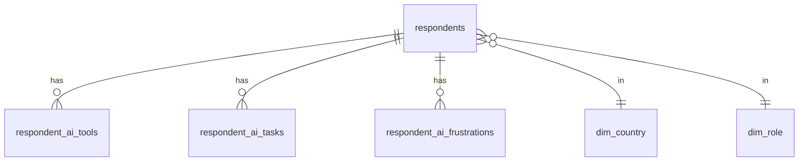

# 06 · Database and SQL

The DuckDB layer: how the clean data is stored and queried. Code: [build_db.py](../src/build_db.py) and [sql/](../sql/).

## What DuckDB is here

DuckDB is a small SQL engine that needs no server — it runs queries straight on files. [build_db.py](../src/build_db.py) loads the parquet files into [survey.duckdb](../data/processed/survey.duckdb), then runs the SQL in [sql/](../sql/) to build dimensions, views, and metric tables.

## The tables

The `respondents` fact table links to bridge tables (one row per selected item) and to dimension lookups.

### Fact table

- **`respondents`** — one row per person per year. Holds the clean outcomes (`uses_ai`, `trusts_ai`, `distrusts_ai`) and controls (experience, role, country, age, company size).

### Bridge tables (multi-select)

- `respondent_ai_tools` — AI products/models used.
- `respondent_ai_tasks` — what people use AI for.
- `respondent_ai_frustrations`, `respondent_ai_benefits`, `respondent_ai_challenges`.

### Dimension tables (lookups)

- `dim_experience`, `dim_org_size`, `dim_role`, `dim_country`, `dim_trust`, `dim_year` — give each code a label and a sort order.

## The SQL files

- **[01_views.sql](../sql/01_views.sql)** — builds the dimensions and helper views, including `v_resp_dims`, which reshapes the data to one row per person per segment dimension.
- **[02_segment_metrics.sql](../sql/02_segment_metrics.sql)** — builds the metric tables: `segment_metrics`, `task_trust`, `tool_trust`, and the year-level `headline`.

## Two rules baked into the SQL

- **Small segments hidden.** Any segment with fewer than 100 people in the trust base is dropped (`HAVING ... >= 100`).
- **Correct bases.** Adoption is measured on everyone who answered; trust only on current AI users.

## Exports for BI tools

`build_db.py` also writes CSVs to `data/processed/powerbi/` (a slim `fact_respondents`, the bridges, the dimensions, and pre-aggregated metrics) so the Power BI kit in [dashboard/powerbi/](../dashboard/powerbi/) can read them.
