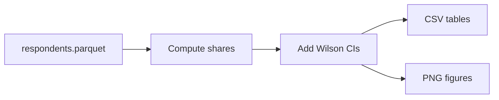

# 07 · Descriptive Analysis

The "who trusts AI?" charts and tables, with honest error bars. Code: [descriptives.py](../src/descriptives.py).

## What this step does

It reads [respondents.parquet](../data/processed/respondents.parquet), keeps professional developers, and measures adoption and trust by year and by segment. It saves CSV tables to `reports/tables/` and PNG charts to `reports/figures/`.

Shares are computed per segment, given confidence intervals, then written as tables and charts.

## The segments

Adoption and trust are broken down by:

- experience (years coding), role, company size, country, age
- AI use type (what people use AI for) and AI tool used
- 2025 extras: use frequency and the "almost right" frustration

## Good-practice rules (why the charts are trustworthy)

- **Confidence intervals.** Every proportion gets a 95% Wilson interval (`wilson_ci` in [stats_utils.py](../src/stats_utils.py)), so you can see how certain each number is.
- **Minimum sample.** Segments with fewer than 100 people (`MIN_N` in [config.py](../src/config.py)) are hidden.
- **Clear base.** Each chart states its denominator, e.g. "professional developers who use AI".
- **Consistent colours.** The same colour means the same thing everywhere (see [viz.py](../src/viz.py)).

## Key figures produced

- `fig01` — the headline adoption-vs-trust trend.
- `fig02` — official vs comparable trust (why the base matters).
- `fig03`–`fig06b` — distrust by experience, role, company size, country, age.
- `fig07`–`fig10` — the 2025 deep dive (segments, tasks, frustrations, use frequency).
- `fig11` — who answered each year (sample composition).

## The takeaway it sets up

The descriptive charts show the gap (adoption rising, trust falling) and which groups distrust most. The regression step ([08-regression-models.md](08-regression-models.md)) then checks which of those patterns survive once everything is controlled for at once.
