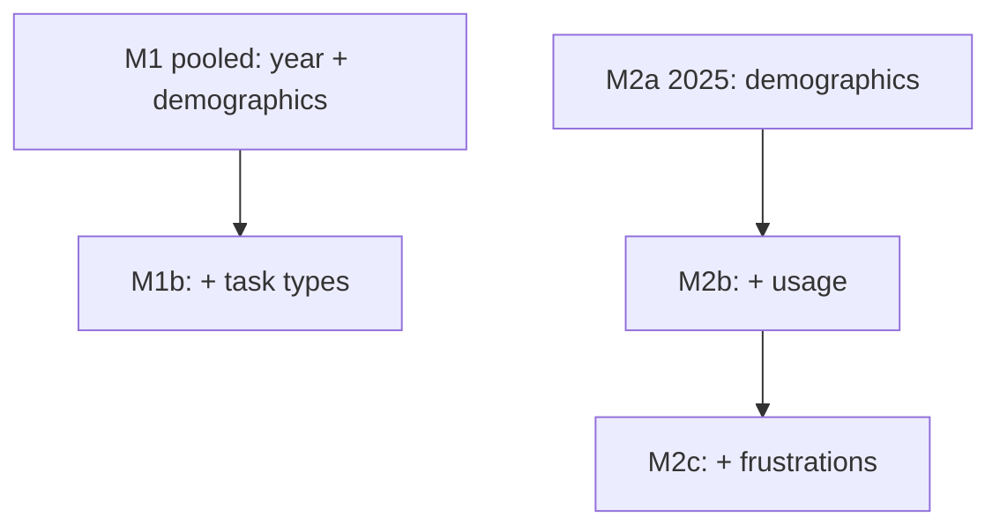

# 08 · Regression Models

Finding what is linked to distrust once everything else is held constant. Code: [models.py](../src/models.py).

## Why regression

A simple chart can mislead: maybe senior developers distrust AI only because they use it differently. Logistic regression separates the factors by estimating each one's effect while holding the others steady.

- **Outcome:** `distrusts_ai` (1 = somewhat or highly distrust AI accuracy).
- **Sample:** professional developers who currently use AI and answered the trust question.
- **Wording rule:** results are *associations*, never causes.

## The models, built up in steps

M1 asks whether distrust rose over time; the 2025 models (M2a–M2c) add usage and frustrations one layer at a time.

| Model | Adds | Question it answers |
|---|---|---|
| M1 | year + experience, role, size, country, age | Did distrust rise, controlling for who answered? |
| M1b | + 8 task types | Does how AI is used explain it? |
| M2a–M2c | 2025 only: demographics → usage → frustrations | What matters most in 2025? |

## How results are reported

- **Odds ratios** with 95% intervals, drawn as forest plots (`fig12a`, `fig12b`). Above 1 = more distrust.
- **Average marginal effects** in percentage points — plain-language "this raises the chance of distrust by X points".
- **Stepwise chart** (`fig13`) showing whether the experience effect shrinks as usage and frustrations are added.
- Tables saved to `model_coefficients.csv` and `model_fit.csv` in `reports/tables/`.

## Technical notes

- Standard errors are robust (HC1), set in the `fit()` helper in [models.py](../src/models.py).
- Reference groups (what each category is compared against) are fixed in the `REF` dictionary, e.g. experience is compared to "0–4 yrs".
- Missing control values become an explicit "Missing" category rather than dropping the row.

## Main finding it supports

Distrust is higher in 2025 than 2023 even with controls, experience is the strongest personal predictor, and the "debugging AI code takes longer" frustration tracks distrust more than the famous "almost right" one.
