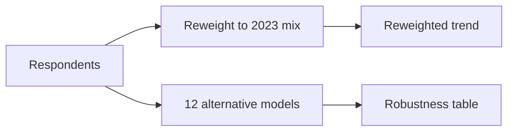

# 09 · Robustness and Weighting

Checking the findings are not just an artefact of who chose to answer. Code: [robustness.py](../src/robustness.py), helpers in [stats_utils.py](../src/stats_utils.py).

## The worry

Survey respondents are self-selected — a different mix of people answered each year. Maybe trust "fell" only because a different crowd showed up. This step tests that.

## Two checks

One check reweights each year to look like 2023; the other re-runs the key models many different ways.

### 1. Reweighting (raking)

- `raking_weights()` adjusts 2024 and 2025 so their mix of country, experience, age, and company size matches 2023.
- `rake()` in [stats_utils.py](../src/stats_utils.py) does this with iterative proportional fitting; weights are trimmed to 0.2–5.
- Result: `fig15` shows the trend both unweighted and reweighted. The decline survives — so it is not just a different crowd.

### 2. Alternative specifications (12 of them)

The key associations are re-estimated under different choices, for example:

- ordered logit on the full 5-point trust scale
- outcome = "highly distrust" only
- excluding the United States
- complete cases only
- all respondents, not just professionals

`fig14` shows every key finding across every specification. Findings that hold everywhere are the ones quoted in the memo.

## Technical note

The ordered-logit model is a custom fast implementation (`ordered_logit` in [stats_utils.py](../src/stats_utils.py)) — same result as statsmodels' `OrderedModel` but quick enough for ~80k rows.

## Why it matters

This is the project's honesty check. Only conclusions that survive reweighting and the alternative models are presented as findings; everything else is reported with caveats.
