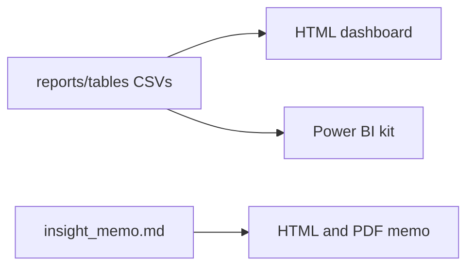

# 10 · Dashboard and Memo

Turning the analysis into things people actually read. Code: [dashboard.py](../src/dashboard.py), [memo.py](../src/memo.py).

## The three outputs

The dashboard and Power BI kit are built from the aggregated tables; the memo is built from a markdown file.

## 1. HTML dashboard

- Built by [dashboard.py](../src/dashboard.py) into one file: [dashboard/ai_trust_dashboard.html](../dashboard/ai_trust_dashboard.html).
- It is **self-contained** — Plotly.js is embedded, so it works offline. Just open it in a browser.
- It reads only the aggregated tables in `reports/tables/`, so **no individual responses are inside it**.

## 2. Insight memo

- Source is [reports/insight_memo.md](../reports/insight_memo.md) (written by hand).
- [memo.py](../src/memo.py) converts it to HTML, embeds the chart images as base64, then prints it to PDF using headless Edge or Chrome.
- If no browser is found, it still writes the HTML and tells you to print to PDF yourself.
- Output: [reports/insight_memo.pdf](../reports/insight_memo.pdf).

## 3. Power BI kit

In [dashboard/powerbi/](../dashboard/powerbi/):

- `POWERBI_BUILD_GUIDE.md` — step-by-step build instructions.
- `DAX_measures.dax` — the measures (Adoption %, Trust %, Distrust %, Trust Gap).
- `theme_ai_trust.json` — the colour theme.
- It reads the CSVs that `build_db.py` exports to `data/processed/powerbi/`.

## Why three formats

- **Dashboard** — quick interactive exploration, shareable as one file.
- **Memo** — a 2-minute read for a busy leader.
- **Power BI** — for teams who already live in Power BI.
