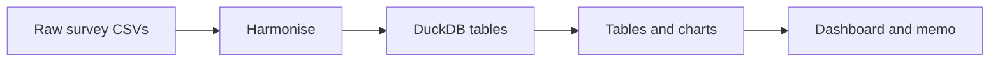

# Project Docs

Beginner-friendly guide to the **Developer AI Adoption vs Trust** analysis.

This project studies the Stack Overflow Developer Survey 2023–2025 (~204k responses) to answer one question: *developers use AI more each year but trust it less — who distrusts it, and why?* It is a Python data pipeline that cleans the data, runs statistics, and builds a dashboard and a memo.

## Read in this order

1. [01-overview.md](01-overview.md) — what the project does, who it is for, the tech stack
2. [02-architecture.md](02-architecture.md) — the 9 pipeline steps and how the modules connect
3. [03-folder-structure.md](03-folder-structure.md) — what each folder and file is for
4. [04-data-flow.md](04-data-flow.md) — how one survey answer moves from raw file to dashboard
5. [05-harmonisation-and-crosswalk.md](05-harmonisation-and-crosswalk.md) — lining up questions across years (the core work)
6. [06-database-and-sql.md](06-database-and-sql.md) — the DuckDB tables and SQL layer
7. [07-descriptive-analysis.md](07-descriptive-analysis.md) — segment tables and charts
8. [08-regression-models.md](08-regression-models.md) — the logistic regression models
9. [09-robustness-and-weighting.md](09-robustness-and-weighting.md) — bias checks and reweighting
10. [10-dashboard-and-memo.md](10-dashboard-and-memo.md) — the dashboard, memo, and Power BI kit
11. [11-setup-run-and-test.md](11-setup-run-and-test.md) — install, run, and test the project

## The big picture

This shows the whole pipeline: raw data is cleaned, stored in a database, turned into charts, and published as a dashboard and memo.
