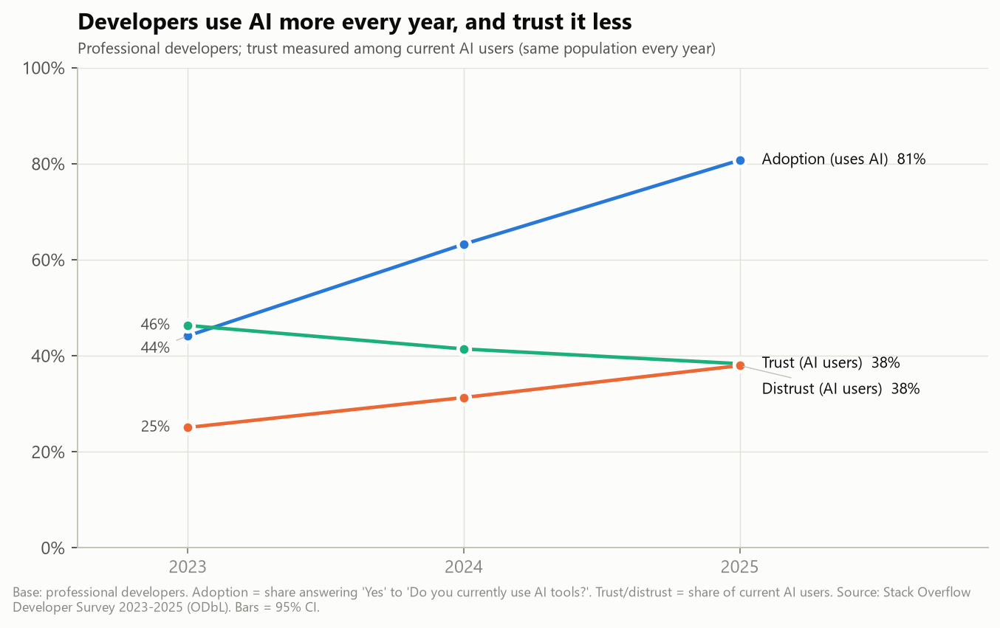
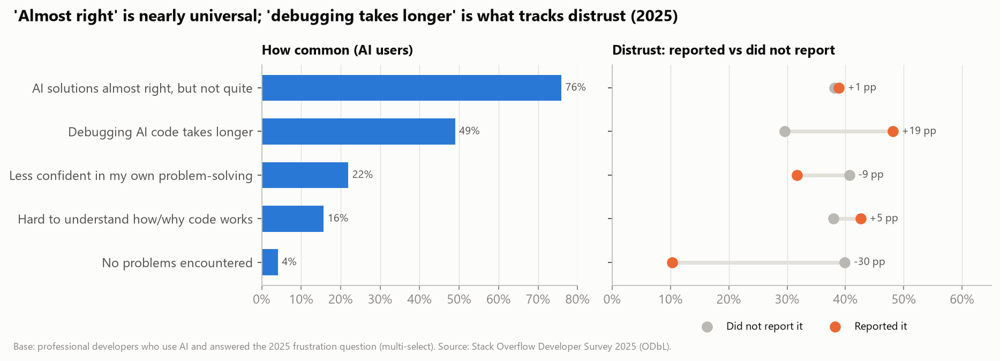

# Developers use AI more every year, and trust it less

**Insight memo · Stack Overflow Developer Survey 2023–2025 · For developer-tools product teams and engineering leaders**

> **Bottom line.** Among professional developers, AI adoption nearly doubled in two years (44% → 81%). Over the same period, distrust of AI output among people who *use* AI rose from 25% to 38%. By 2025, users are as likely to distrust AI accuracy as to trust it.
>
> Distrust is highest among **experienced developers**, **occasional users** and people for whom **fixing AI output is slow**. The widely quoted "almost right, but not quite" frustration is real, but it is nearly universal (76% of professional AI users), so on its own it does **not** separate trusters from distrusters. **The cost of debugging AI output is what tracks distrust.**

## Key findings

**1. The trust decline is real and not just "a different crowd".** Among professional AI users, trust fell from 46% (2023) to 41% (2024) to 38% (2025), and distrust rose from 25% to 31% to 38%.

- **Holding the respondent mix constant:** with experience, role, company size, country and age controlled, the odds of distrust were **1.87× higher in 2025 than in 2023** (+13 percentage points).
- **After reweighting** 2024 and 2025 to look like the 2023 sample, distrust still rises from 25% to 39%.
- **Caution on the official numbers:** Stack Overflow's own tables show trust as flat from 2023 to 2024 (42% → 43%) and then falling to 33% in 2025. Those tables use a different population each year: users + planners in 2023, users only in 2024, everyone including non-users in 2025. Comparing like with like (current AI users) shows a steady decline in every year.

**2. Experience is the strongest personal predictor of distrust.** In 2025, 25% of AI users with 0–4 years of coding distrust AI, against 43% of those with 30+ years.

- **Size:** with controls, 30+ years vs 0–4 years means about **3× the odds** of distrust.
- **Use patterns explain only part of it.** Adding use frequency, agents, task types and frustrations shrinks the gap from +29 pp to +21 pp. Most of the experience effect remains. Seniors don't distrust AI only because they use it differently; they judge the same output more harshly.
- **Age vs experience:** at a given experience level, *older* developers distrust less. Experience, not age, drives the effect.

**3. Use goes with trust: occasional users are the most sceptical.** In 2025, distrust is 28% among daily users, 48% among weekly users and 66% among monthly-or-less users.

- **Size:** monthly vs daily means 3.3× the odds, with controls.
- **Agents:** people who use AI agents are 6 pp less likely to distrust than people who don't.
- **Direction is unknown.** Trust may drive use as much as use builds trust.

**4. "Almost right" is not the differentiator; "debugging takes longer" is.**

| 2025 frustration (professional AI users) | Share reporting it | Odds ratio for distrust (full model) | Change in P(distrust) |
|---|---|---|---|
| AI solutions "almost right, but not quite" | 76% | 0.97 (n.s.) | ~0 pp |
| Debugging AI-generated code takes longer | 49% | **2.22** | **+15 pp** |
| Hard to understand how/why the code works | 16% | 1.14 | +2 pp |
| Less confident in my own problem-solving | 22% | 0.77 | −5 pp |
| No problems encountered | 4% | 0.27 | −21 pp |

- **Every way we tested it,** "almost right" stays at or near zero (odds ratio between 0.89 and 1.08).
- **What matters is what an imperfect answer costs.** Users who say fixing AI code is slower are far more likely to distrust it.
- **An over-reliance warning sign:** users who feel *less* confident in their own problem-solving trust AI *more*.

**5. Who is most and least sceptical (2025, AI users).**

- **By role:** embedded/hardware developers distrust most (50%), followed by research and DevOps/infra. QA, data/ML and front-end developers distrust least (28–32%).
- **By country:** Switzerland, Sweden and Germany are highest (about 50%), with the UK, US and Canada close behind (47–48%). India (14%) and Ukraine (24%) are lowest, and these gaps persist with controls.
- **By company size:** larger companies look slightly more sceptical in the raw numbers, but there is **no association once role, experience and country are controlled.**
- **By type of AI use:** people who use AI for deployment, predictive analytics, debugging or planning report less distrust. This most likely reflects trusting users delegating more, not those tasks building trust.

## What this means

**For developer-tools product teams**

1. **Optimise for the cost of fixing, not only first-answer accuracy.** Fast verification makes debugging cheaper: inline tests, diffs against the codebase, citations, confidence signals, one-click revert. That cost is the frustration that tracks distrust.
2. **Design for sceptical senior users.** Give them explicit uncertainty, explanations they can check, and controls over scope. Seniors are both the most sceptical group and the people who approve team-wide rollouts.
3. **Move occasional users to habitual use.** The trust gap between monthly and daily users is the largest gap in the data. Onboarding that delivers early, verifiable wins is a trust lever.

**For engineering leaders planning AI rollouts**

1. **Expect high adoption with low trust, and plan review processes accordingly.** In 2025, 81% of professional developers use AI, but only 38% of users trust its accuracy.
2. **Track debugging and rework time, not just usage.** Rising "debugging takes longer" is an early warning that trust, and the value of the rollout, is eroding.
3. **Watch for over-reliance.** People who lose confidence in their own problem-solving trust AI more, which is a coaching and code-review issue.
4. **Read country and role gaps as context, not destiny.** Pilot with teams whose work matches the tasks where users report the least distrust.

## Caveats

- **Self-selected sample.** Respondents are developers engaged enough with Stack Overflow to take a long survey. Results do not represent all developers. Reweighting corrects only the *observed* mix: country, experience, age and company size.
- **2025 missing answers.** The AI section was optional in 2025, and about 31% of 2025 respondents skipped it.
- **Associations, not causes.** The data is cross-sectional and self-reported. For example, trust may cause frequent use rather than the reverse.
- **Changed questions.** Every mapping is documented in `mappings/question_crosswalk.csv`. Questions that exist in only one year (frustrations, agents, use frequency) are analysed within 2025 only.
- **Figures quoted from Stack Overflow** use its official tables, which our pipeline reproduces to within 0.6 pp (84 of 84 checks): 2025 trust 32.8%, distrust 45.7%, "almost right" 66.0%, and 84% using or planning to use AI. Our own trend figures use the comparable "current AI users" base and are labelled as such.

*Method: Python (pandas, statsmodels), DuckDB SQL. Logistic regressions with robust standard errors; average marginal effects are reported in percentage points. Robustness checks: ordered logit, "highly distrust" outcome, excluding the US, complete cases, professional experience, reweighted sample, all coders. Full code: `run_pipeline.py`. Data: Stack Overflow Developer Survey 2023–2025, Open Database License (ODbL).*
